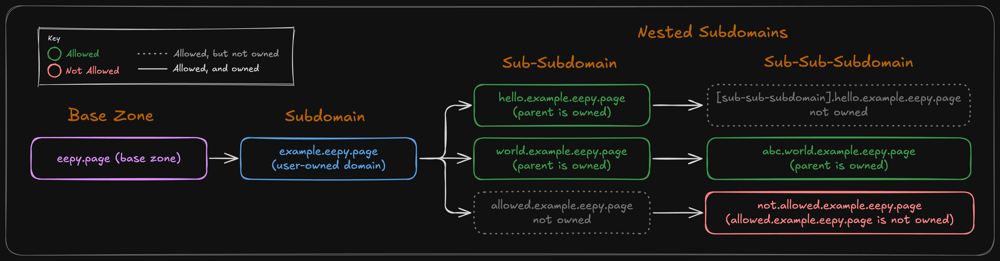

# DNS & Subdomains

eepy.page uses PowerDNS as the public authoritative nameserver, driven by our Python backend and MongoDB. This guide explains how domains, record types, TLDs, and subdomain hierarchies work across the API. Understanding internals allows you to understand how the service as a whole works.

---

## Supported Record Types

The API supports registration of four record types. All other record types are banned.

| Record Type | Description | Values Format | Example Value |
| :--- | :--- | :--- | :--- |
| **`A`** | For IPv4 addresses | Valid IPv4 address | `["192.0.2.1"]` |
| **`AAAA`** | For IPv6 addresses | Valid IPv6 address | `["2001:db8::1"]` |
| **`CNAME`** | Creating aliases to another hostname | Valid FQDN hostname | `["example.com"]` |
| **`TXT`** | Arbitrary text (often used for verification) | Any string | `["verification-value"]` |

!!! note "Record value structure"
    The `values` field in API payloads is always an array of strings (e.g. `["1.1.1.1"]`), even when specifying a single target.
    
    This is so the structure is consistent whether you're setting one value or multiple (e.g. `["1.1.1.1", "1.0.0.1"]`).

---

## Available Zones

All domains registered on eepy.page are subdomains under supported parent zones.

1. **Default Zone**: By default, all registered accounts can create subdomains under `eepy.page`.
2. **Additional Zones**: Accounts can purchase access to additional domains.
3. Attempting to register a subdomain under an unowned TLD returns HTTP `401 Unauthorized`.

---

## Subdomain Ownership Hierarchy

eepy.page uses an ownership hierarchy for subdomains. Owning a domain gives you permission to register subdomains beneath it.

These subdomains are not automatically registered to your account—you must register each one individually before you can manage it. (However, they are locked to your account, meaning if you register `example.eepy.page`, nobody can register `an.example.eepy.page` except for you.)

Example: if you own `example.eepy.page`, you can register `dev.example.eepy.page`, `blog.example.eepy.page`, or any other subdomain beneath it. Once you register `dev.example.eepy.page`, you can also register subdomains beneath that, such as `api.dev.example.eepy.page`.

To be clear: **you must own every parent domain in a subdomain's hierarchy to register it.** Having permission to register a domain does not mean you own it, and you cannot register subdomains beneath a domain you haven't registered yourself.

The flowchart below illustrates how this hierarchy works.

### How the hierarchy impacts API usage

1. **Parent ownership for registration**: If you do not own the parent subdomain, [`POST /api/domain`](endpoints/register-domain.md) rejects the request with HTTP `403 Forbidden`.
2. **Subdomain protection on deletion**: To prevent orphaned records, you cannot delete a domain if child subdomains still exist underneath it. For instance, if you own `dev.yourname.eepy.page` and `api.dev.yourname.eepy.page`, you must delete `api.dev.yourname.eepy.page` first. Calling [`DELETE /api/domain`](endpoints/delete-domain.md) on the parent will return HTTP `400 Bad Request`.
